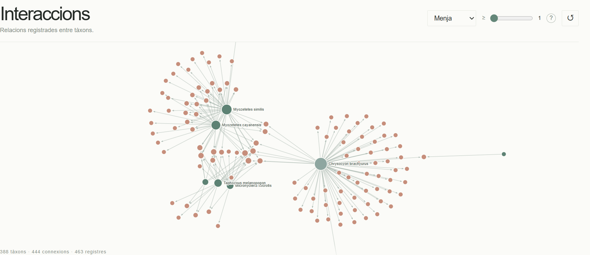
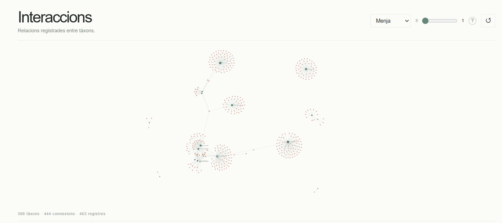
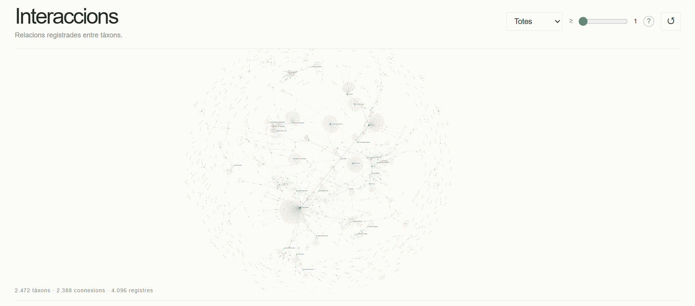

# Interaccions entre tàxons

Visualització interactiva de les relacions biològiques registrades entre tàxons. El projecte representa les interaccions com una xarxa dirigida: els **nodes** són tàxons i les **connexions amb fletxa** indiquen la direcció de la relació registrada.

La interfície està dissenyada per explorar la xarxa de manera progressiva: filtres per tipus i freqüència, zoom i una finestra de detalls que apareix en seleccionar un node.


La xarxa es pot explorar amb zoom per veure els tàxons i les seves connexions amb més detall.




La distribució espacial ajuda a identificar grups de tàxons connectats i components separats de la xarxa.



En seleccionar «Totes», la visualització incorpora les relacions dels diferents tipus que hi ha al fitxer després del tractament de les dades.



## Funcionalitats

- **Filtre per tipus d'interacció:** mostra totes les relacions o filtra per «Menja», «Paràsit de» i «Depreda».
- **Freqüència mínima:** amaga les connexions que representen menys registres dels indicats pel control.
- **Zoom i arrossegament:** permet explorar regions de la xarxa i moure els nodes.
- **Detalls sota demanda:** en seleccionar un node, s'obre un panell amb el nombre de connexions entrants i sortints, els registres associats i la llista de connexions visibles.
- **Reinici dels filtres:** torna als valors inicials de la visualització.
- **Resum dinàmic:** mostra el nombre de tàxons, connexions agrupades i registres representats en la vista actual.
- **Interfície en català:** els tipus d'interacció originals es conserven a les dades i es mostren traduïts a la interfície.

## Com s'han tractat les dades?

El fitxer d'origen conté **4.097 files**. Després d'excloure els registres sense la informació necessària per construir una relació —tàxon d'origen, tàxon de destinació i tipus d'interacció—, la visualització treballa amb **4.096 registres** identificats per tipus d'interacció:

| Tipus original | Etiqueta a la interfície | Registres |
|---|---|---:|
| `parasiteOf` | Paràsit de | 3.622 |
| `eats` | Menja | 463 |
| `preysOn` | Depreda | 11 |
| **Total** | | **4.096** |

Les files originals no es representen necessàriament com connexions independents. Abans de dibuixar la xarxa, els registres s'agrupen per la combinació exacta de:

1. tàxon d'origen (`source_taxon_name`);
2. tàxon de destinació (`target_taxon_name`);
3. tipus d'interacció (`interaction_type`).

Cada combinació única es converteix en una connexió dirigida. La propietat `weight` indica quantes files originals s'han agrupat en aquella connexió. Per exemple, si una mateixa relació entre dos tàxons i un mateix tipus d'interacció apareix tres vegades, es dibuixa una sola connexió amb `weight = 3`.

Per això, el nombre de connexions és inferior al nombre de registres originals: **les connexions agrupades resumeixen els registres repetits, no els eliminen del recompte**. El total de registres que apareix a la visualització es calcula sumant els pesos de les connexions visibles. Quan s'aplica un filtre de tipus o de freqüència, els recomptes es recalculen per a la selecció actual.

### Què representa cada element?

- **Node:** un tàxon que participa en almenys una connexió visible.
- **Fletxa:** una relació dirigida des del tàxon d'origen fins al tàxon de destinació.
- **Gruix de la connexió:** reflecteix el nombre de registres originals agrupats (`weight`).
- **Mida del node:** depèn del nombre de connexions entrants i sortints que té dins de la xarxa visible.
- **Color del node:** diferencia tàxons amb connexions sortints, entrants o ambdues, segons la seva funció en la vista actual.

Els recomptes depenen dels filtres actius. Per tant, les xifres que apareixen al peu del gràfic descriuen **la vista actual**, no necessàriament tota la xarxa.

## Font i citació

**Font de les dades:** [Global Biotic Interactions (GloBI)](https://www.globalbioticinteractions.org/), una infraestructura oberta que reuneix dades d'interaccions entre organismes procedents de diferents conjunts de dades i estudis.

**Fitxer d'origen:** `interaction.csv`.

**Citació:**

Poelen, J. H., Simons, J. D., & Mungall, C. J. (2014). *Global Biotic Interactions: An open infrastructure to share and analyze species-interaction datasets*. *Ecological Informatics, 24*, 148–159. https://doi.org/10.1016/j.ecoinf.2014.08.005

Enllaços útils: [web de GloBI](https://www.globalbioticinteractions.org/) · [dades i descàrregues](https://www.globalbioticinteractions.org/data) · [com citar GloBI](https://www.globalbioticinteractions.org/about).

## Tecnologies

- **HTML5** — estructura de la pàgina.
- **CSS3** — disseny, tipografia, colors i adaptació de la interfície.
- **JavaScript** — tractament de les dades i lògica de les interaccions.
- **D3.js v7** — representació SVG de la xarxa, simulació de forces, zoom i arrossegament.

D3.js es carrega des d'un CDN, de manera que cal connexió a internet perquè la visualització es carregui completament.

## Estructura del projecte

```text
network-interactions-catalan/
├── index.html
├── README.md
├── assets/
│   ├── network-menja-detall.png
│   ├── network-menja-general.png
│   └── network-totes-les-interaccions.png
├── css/
│   └── style.css
├── js/
│   ├── app.js
│   └── interactions-data.js
└── data/
    └── interactions.csv
```

- `index.html`: estructura de la pàgina i controls.
- `css/style.css`: estils de la visualització i dels panells emergents.
- `js/app.js`: agrupa els registres, aplica els filtres, calcula els indicadors i dibuixa la xarxa.
- `js/interactions-data.js`: dades incorporades al JavaScript perquè es puguin carregar sense una petició `fetch` al CSV.
- `data/interactions.csv`: còpia del fitxer de dades per a consulta i traçabilitat.
- `assets/`: captures incloses en aquest README.


## Limitacions i interpretació

Les dades reflecteixen les interaccions documentades en els conjunts d'origen disponibles a GloBI; no són un inventari complet de totes les interaccions que existeixen a la natura. La cobertura depèn dels estudis, organismes i fonts incorporats a la base de dades. Els registres repetits poden correspondre a observacions o referències diferents de la mateixa combinació de tàxons i tipus d'interacció.

A més, els tàxons poden aparèixer en diferents nivells de classificació i la xarxa visible canvia amb els filtres. La mida dels nodes i la distribució espacial serveixen per explorar les relacions, però no s'han d'interpretar com una mesura directa de l'abundància dels organismes o de la intensitat ecològica de la interacció.

---

*Projecte de visualització interactiva de dades d'interaccions biològiques amb finalitats exploratòries i informatives.*
